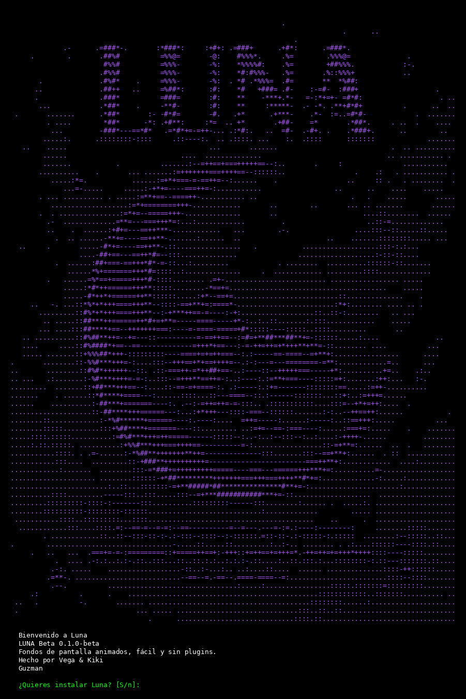
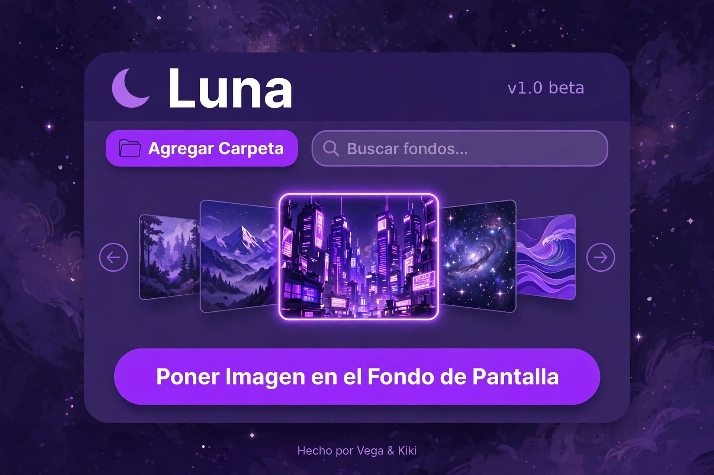
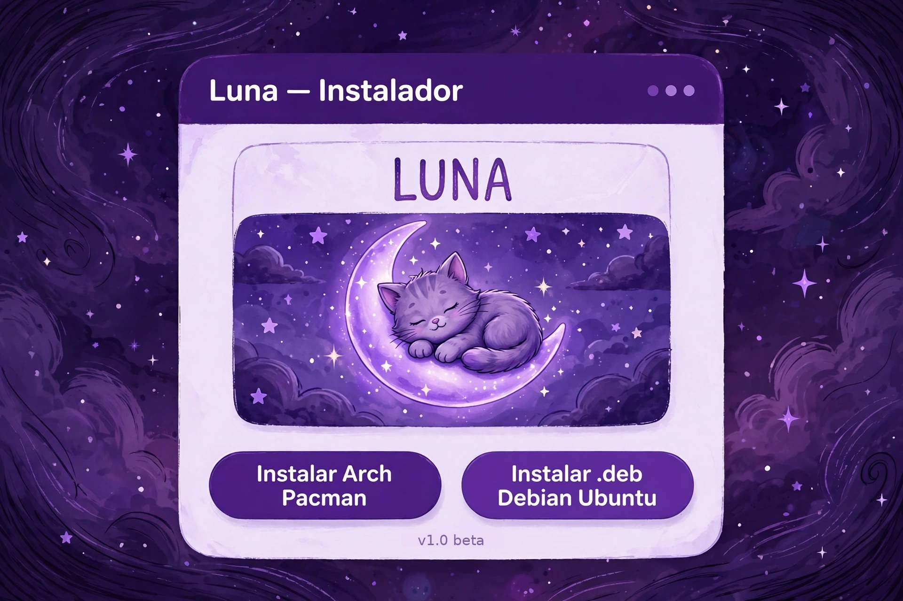
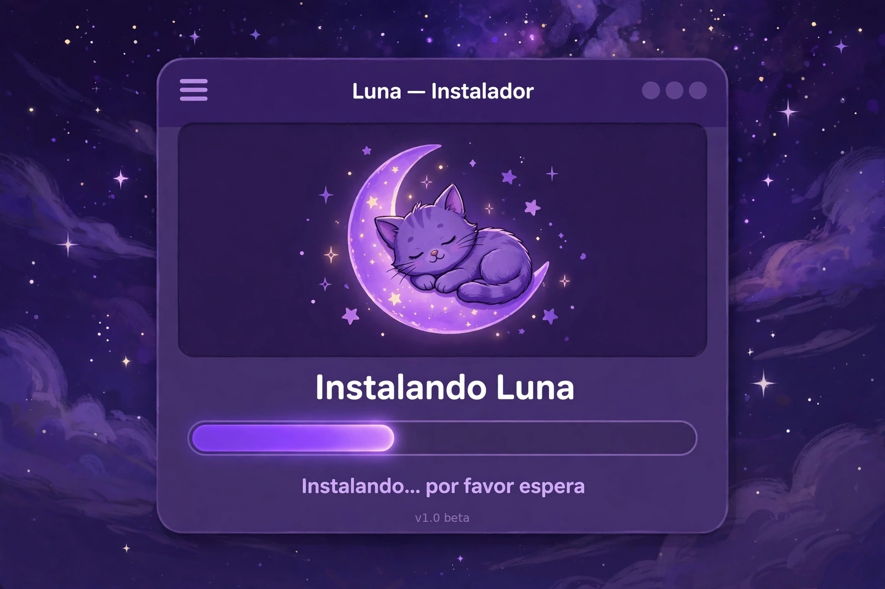
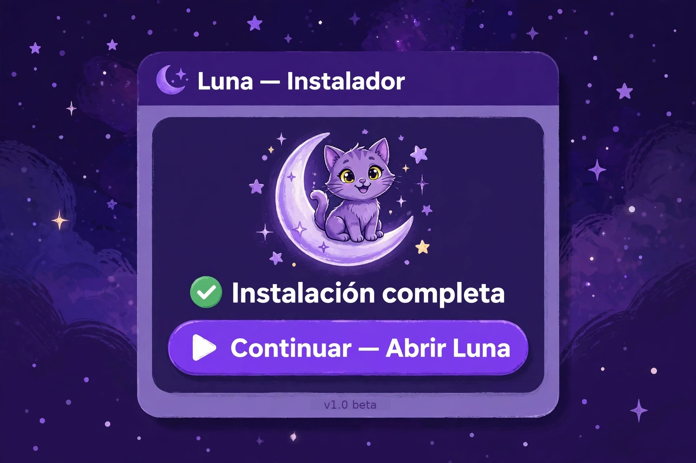

<div align="center">

# 🌙 LUNA

### Fondos de pantalla animados en Linux, fácil y sin plugins

**Pica, elige tu fondo… y listo. Sin terminal, sin complicarte.**

`v1.0` &nbsp;•&nbsp; 🐧 Linux &nbsp;•&nbsp; 🟡 Arch / Pacman &nbsp;•&nbsp; 🌀 Debian / Ubuntu (.deb) &nbsp;•&nbsp; 📜 MIT

> **✨ Estable:** Luna v1.0. Versión estable, ya funciona bien.



</div>

---

## 🌙 ¿Qué es Luna?

Luna es una app para poner **fondos de pantalla animados**, fácil y sin plugins, para el **usuario común** en Linux.

Pones un **video o una foto como fondo** de tu escritorio, sin terminal y sin complicarte. Solo picas, no escribes comandos.

---

## ✨ ¿Qué hace Luna?

| | Función |
|---|---|
| 🎬 | **Video como fondo** de pantalla, automáticamente |
| 🖼️ | **Imagen como fondo** de pantalla, automáticamente |
| 🎠 | **Carrusel 3D** para elegir tu fondo, con vista grande |
| 🖱️ | **Clic derecho** en una imagen o video: **Poner con Luna** lo pone como fondo, y **Abrir Luna** abre la ventana |
| 🧰 | Luna va directo al menú **Inicio > Utilidades** |
| ⏸️ | **Pausa inteligente**: al maximizar, a pantalla completa, por la batería y si se apaga la pantalla |
| 🔊 | **Volumen y silencio** |
| 🖥️ | **Multi-monitor** |
| 🚀 | **Inicio automático** |
| 🎞️ | **Mejoras de video**: escalado IA, nitidez, estabilización, reducción de ruido, HDR y desenfoque |
| 🐱 | **Acerca de Luna**, en su propia ventana, con el póster y toda la información — y **Funciones** adentro, como submenú |

---

## 🖼️ Formatos

| Imágenes | Videos |
|---|---|
| JPG, PNG, WEBP, GIF, BMP, SVG | MP4, MKV, WEBM, MOV, AVI |

---

## 🚀 Cómo se usa

1. Abre Luna desde **Inicio > Utilidades**.
2. Pica **➕ Agregar Carpeta** en la barra superior y elige la carpeta donde tienes tus imágenes. Se cargan todas las imágenes y videos de esa carpeta.
3. Elige tu fondo en el **carrusel 3D**.
4. Pica **🖼️ Poner Imagen en el Fondo de Pantalla**.

<div align="center">



</div>

> **O, más fácil todavía:** haz **clic derecho** en una imagen o video y elige **Poner con Luna**. 🖱️✨

---

## 📦 Instalación en solo 3 pasos

### 1️⃣ Instalar

Pica **Instalar Arch Pacman** o **Instalar .deb Debian Ubuntu**. La contraseña va al instalador, no se pide en la terminal.



### 2️⃣ Proceso

Barrita animada, despacio, instalando Luna del 1 al 100.



### 3️⃣ Continuar / Finalizar

Pica **▶ Continuar — Abrir Luna**, y se abre el programa.



**Sin tantos comandos. Solo picas y listo.** 🎉

---

## 💻 Comandos

### 🌀 Debian / Ubuntu (.deb)

```bash
curl -L https://github.com/lunagave/Lunagave/raw/main/luna_1.0_all.deb -o ~/Descargas/luna_1.0_all.deb && cd ~/Descargas && sudo dpkg -i luna_1.0_all.deb && sudo apt install -f
```

> Después de instalar el .deb, el comando `luna` ya funciona en la terminal. El .deb instala solo la versión de terminal (luna set, luna stop, luna list, luna status, luna version); la ventana con el carrusel 3D viene con el Luna Launcher en Arch.

### 📦 Instalar manualmente el .zip / .tar.gz / .deb

Si prefieres instalar Luna a mano, con el archivo:

**1. Descarga el archivo**
- **Luna Launcher v1.0:** [luna-launcher1.zip](https://github.com/lunagave/Lunagave/blob/main/luna-launcher1.zip)
- O el mismo instalador, Luna Launcher v1.0, en .tar.gz (para Arch, en terminal): [luna-launcher1.tar.gz](https://github.com/lunagave/Lunagave/blob/main/luna-launcher1.tar.gz)
- **Para Debian / Ubuntu, Luna Launcher v1.0:** [luna_1.0_all.deb](https://github.com/lunagave/Lunagave/blob/main/luna_1.0_all.deb)

**2. Descomprime el .zip o el .tar.gz**
- Clic derecho > Extraer, o en la terminal:

```bash
unzip luna-launcher1.zip
```

Si es .tar.gz (para Arch, en terminal):

```bash
tar -xzf luna-launcher1.tar.gz
```

**3. Entra a la carpeta y corre el instalador en la terminal**

```bash
bash luna-installer.sh
```

**4. Sigue los 3 pasos del instalador:** Instalar, Proceso y Continuar — Abrir Luna.

**5. Para instalar el .deb en Debian / Ubuntu**

Solo copia y pega este comando en la terminal, y ya se instala Luna:

```bash
curl -L https://github.com/lunagave/Lunagave/raw/main/luna_1.0_all.deb -o ~/Descargas/luna_1.0_all.deb && cd ~/Descargas && sudo dpkg -i luna_1.0_all.deb && sudo apt install -f
```

O, si ya descargaste el .deb a mano:

```bash
sudo dpkg -i luna_1.0_all.deb
```

Si pide dependencias, corre después:

```bash
sudo apt install -f
```

> El .deb, el .zip y el .tar.gz son de Luna Launcher v1.0.

---

## 🛠️ Instalación desde el código

**En Arch / Garuda:**

```bash
makepkg -si
```

**En Debian / Ubuntu:**

```bash
./build-deb.sh
sudo dpkg -i luna_1.0_all.deb
```

---

## 📂 Archivos

| Archivo | Para qué es |
|---|---|
| `luna.py` | Comandos `luna set`, `luna stop`, `luna list`, `luna status` |
| `luna_gui.py` | La ventana de Luna |
| `luna-installer-gui.py` y `luna-installer.sh` | El instalador en 3 pasos |
| `luna_ascii.py` | Bienvenida en ASCII en la terminal |
| `PKGBUILD` | Paquete para Arch / Pacman |
| `build-deb.sh` y `debian/` | Paquete .deb para Debian / Ubuntu |
| `luna.desktop` y `luna-utilidades.desktop` | Menú Inicio > Utilidades |
| `luna-clic-derecho.desktop` | Clic derecho: Poner con Luna / Abrir Luna |
| `PAGINA_LUNA.md` | Descripción completa del programa |

---

## 🗑️ Desinstalar Luna

### 🟡 En Arch

```bash
sudo pacman -Rns luna
```

### 🌀 En Debian / Ubuntu

```bash
sudo apt remove --purge luna
```

### 🧹 Para borrar también su configuración, en los dos

```bash
rm -rf ~/.config/luna
```

Con eso Luna se borra completa, sin dejar nada. 🗑️✨

---

<div align="center">

### 🌙 Luna v1.0

**Hecho por Vega & Kiki**
**Guzman**

</div>
